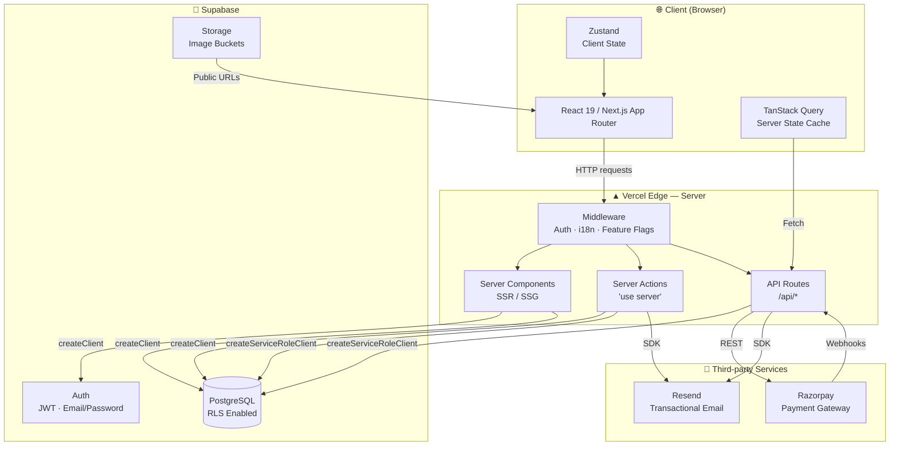
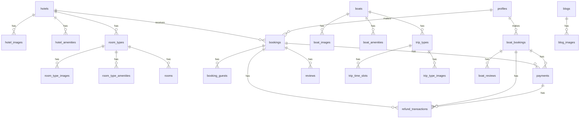
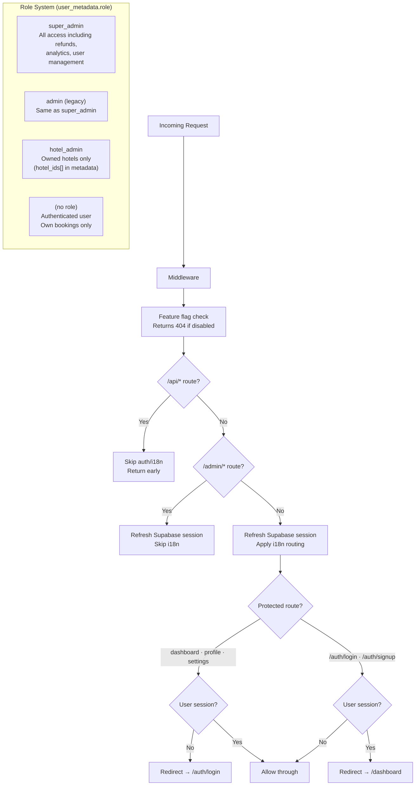
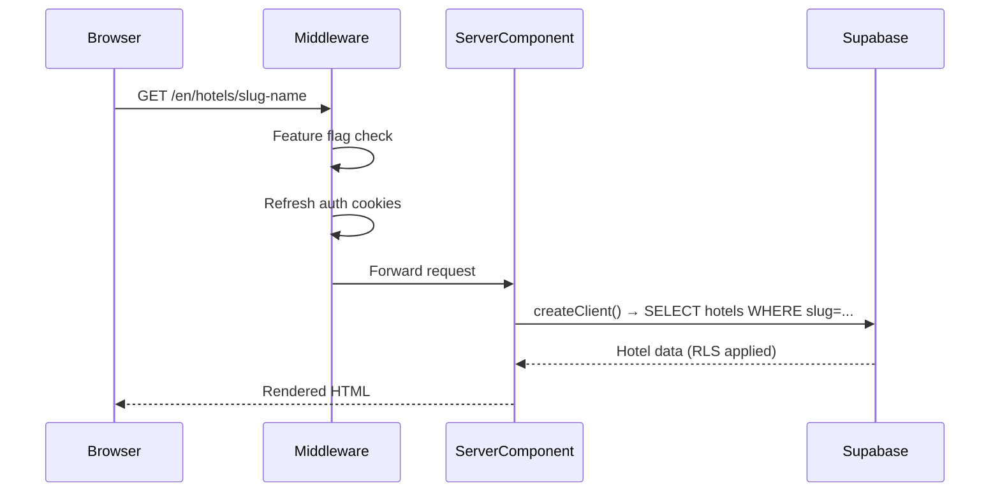
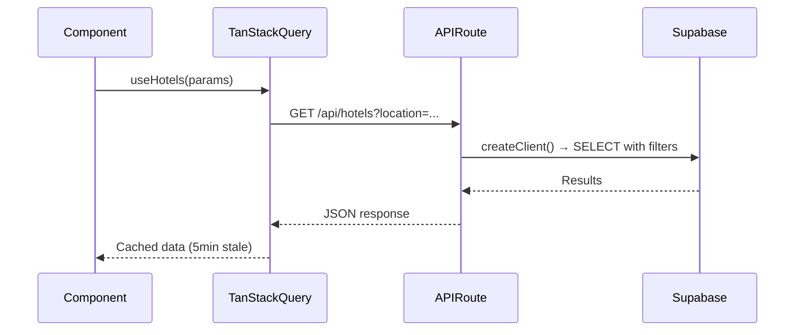
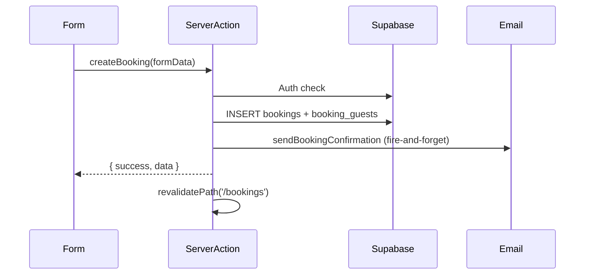
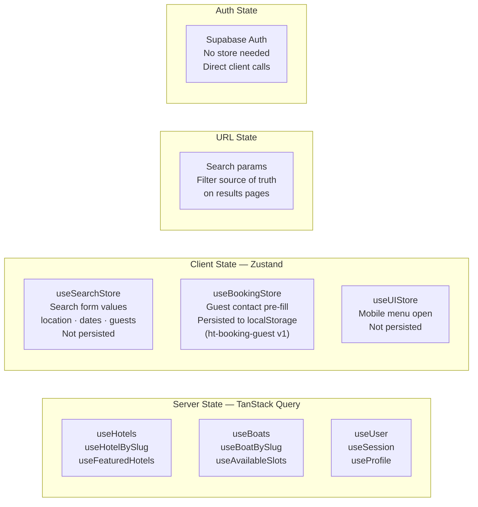
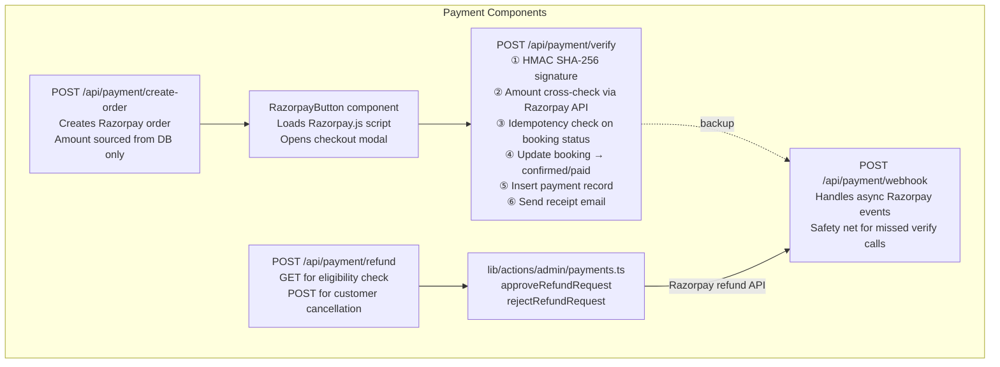
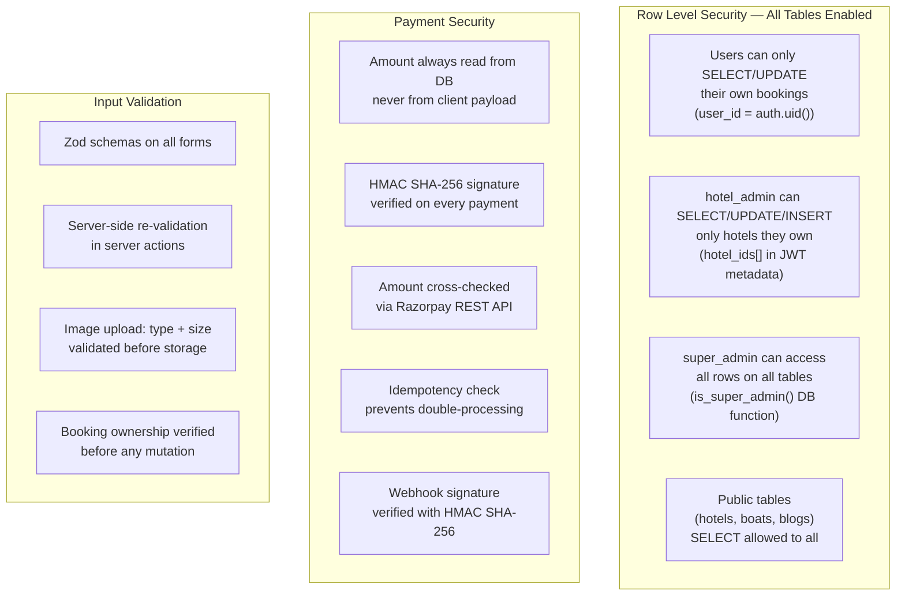
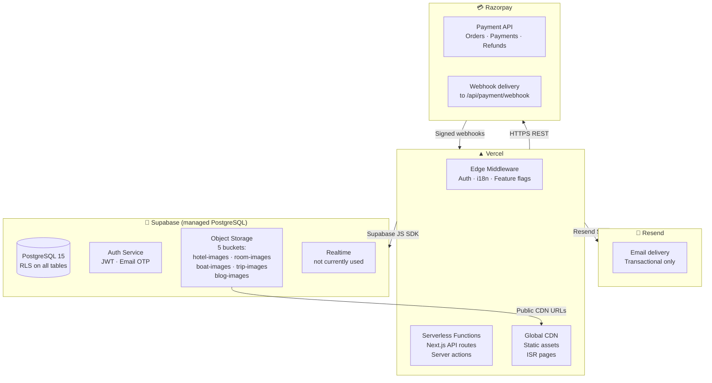

# Triplovia — Architecture & Technical Documentation

> **Stack snapshot:** Next.js 15 · TypeScript · Supabase · Razorpay · Resend · Vercel
> **Last updated:** 2026-04-12

---

## Table of Contents

1. [System Architecture Overview](#1-system-architecture-overview)
2. [Technology Stack](#2-technology-stack)
3. [Application Structure](#3-application-structure)
4. [Data Architecture](#4-data-architecture)
5. [Authentication & Authorization](#5-authentication--authorization)
6. [Request Lifecycle](#6-request-lifecycle)
7. [State Management](#7-state-management)
8. [Payment Architecture](#8-payment-architecture)
9. [Email Architecture](#9-email-architecture)
10. [Internationalization](#10-internationalization)
11. [Feature Flag System](#11-feature-flag-system)
12. [Security Model](#12-security-model)
13. [Infrastructure & Deployment](#13-infrastructure--deployment)

---

## 1. System Architecture Overview



---

## 2. Technology Stack

| Layer | Technology | Version | Purpose |
|-------|-----------|---------|---------|
| Framework | Next.js (App Router) | 15.5.7 | SSR, routing, API routes, server actions |
| Language | TypeScript | 5.x | Type safety across the entire codebase |
| UI Library | React | 19.1.0 | Component rendering |
| Styling | Tailwind CSS 4 | 4.x | Utility-first CSS, OKLCH colour space |
| Components | shadcn/ui (New York) | — | Radix UI primitives + Tailwind |
| Icons | Lucide React | 0.554.0 | Icon set |
| Server State | TanStack Query | 5.90.12 | Caching, background refetch, mutations |
| Client State | Zustand | 5.0.11 | Providerless global stores |
| Database | Supabase PostgreSQL | — | Primary data store with RLS |
| Auth | Supabase Auth | via @supabase/ssr 0.8.0 | JWT-based email/password auth |
| Payments | Razorpay | 2.9.4 | Indian payment gateway |
| Email | Resend + React Email | 6.6.0 | Transactional emails |
| i18n | next-intl | 4.5.5 | Multi-language (en / es / fr) |
| Forms | React Hook Form + Zod | 7.68.0 / 4.1.13 | Form state + schema validation |
| Rich Text | Tiptap | 3.15.3 | Blog editor |
| Dates | date-fns + react-day-picker | 4.1.0 / 9.11.3 | Date formatting and pickers |
| Package Manager | pnpm | — | Fast, disk-efficient installs |
| Hosting | Vercel | — | Edge CDN, serverless functions |

---

## 3. Application Structure

```mermaid
graph TD
    subgraph ROUTES["App Router — Route Groups"]
        G["[locale]/(guest)\nPublic pages\nHotels · Boats · Blog\nAbout · Policies"]
        A["[locale]/auth\nLogin · Signup\nForgot/Reset Password"]
        U["[locale]/dashboard\n[locale]/bookings\n[locale]/boat-bookings\n[locale]/profile\nProtected user pages"]
        P["[locale]/payment\nPayment success page"]
        ADM["admin/*\nNo locale prefix\nFull admin panel"]
        APIR["api/*\nNo locale prefix\nREST API routes"]
    end

    subgraph ADMIN_PAGES["Admin Panel Pages"]
        ADM --> ADM1[analytics]
        ADM --> ADM2[hotels · rooms]
        ADM --> ADM3[boats · trip types]
        ADM --> ADM4[bookings · boat-bookings]
        ADM --> ADM5[payments · refunds]
        ADM --> ADM6[blogs]
        ADM --> ADM7[users]
        ADM --> ADM8[settings]
    end

    subgraph API_ROUTES["API Routes"]
        APIR --> API1[/payment/create-order]
        APIR --> API2[/payment/verify]
        APIR --> API3[/payment/refund]
        APIR --> API4[/payment/webhook]
        APIR --> API5[/hotels · /boats · /blogs]
        APIR --> API6[/bookings · /boat-bookings]
    end

    subgraph LIB["lib/ — Shared Code"]
        LIB1[actions/\nServer Actions]
        LIB2[services/\nBusiness Logic]
        LIB3[hooks/\nTanStack Query]
        LIB4[stores/\nZustand]
        LIB5[supabase/\nClient Factories]
        LIB6[types/\nDomain Types]
        LIB7[utils/\nHelpers]
    end
```

### Directory Map

```
app/
├── [locale]/
│   ├── (guest)/          hotels/, boats/, blog/, about/, policies
│   ├── auth/             login, signup, forgot-password, reset-password, callback
│   ├── dashboard/        user home
│   ├── bookings/         hotel booking list + detail
│   ├── boat-bookings/    boat booking list + detail
│   ├── profile/          user profile settings
│   └── payment/success   post-payment confirmation
├── admin/                full admin panel (no locale)
└── api/                  all REST endpoints (no locale)

lib/
├── actions/
│   ├── admin/            hotel, boat, booking, payment, refund CRUD
│   ├── auth.ts           signIn, signUp, signOut, resetPassword
│   ├── bookings.ts       createBooking, getUserBookings, cancelBooking
│   ├── boat-bookings.ts  createBoatBooking, cancelBoatBooking
│   ├── blogs.ts          getAllBlogs, createBlog, updateBlog
│   ├── reviews.ts        submitReview, getReviewByBookingId
│   └── users.ts          profile management
├── services/
│   ├── email.service.ts        all transactional email methods
│   ├── booking.service.ts      hotel booking calculation + DB insert
│   ├── boat-booking.service.ts boat booking calculation + DB insert
│   ├── hotel.service.ts        hotel search + availability
│   └── boat.service.ts         boat search + slot availability
├── hooks/                TanStack Query hooks (use-hotels, use-boats, use-supabase-query, useRazorpay)
├── stores/               Zustand stores (use-search-store, use-booking-store, use-ui-store)
├── supabase/             server.ts (createClient, createServiceRoleClient), client.ts, middleware.ts
├── razorpay/             config.ts (instance + key constants)
├── config/               features.ts (feature flag map)
├── types/                domain types barrel (hotel, boat, auth, common)
└── utils/                cn(), formatCurrency(), admin guards, storage helpers
```

---

## 4. Data Architecture

### Database Tables



### Hotel Domain Tables
| Table | Purpose |
|-------|---------|
| `hotels` | Hotel master data (name, slug, location, status, pricing) |
| `hotel_images` | Hotel photos linked to Supabase Storage |
| `hotel_amenities` | Hotel-level amenity associations |
| `room_types` | Room categories with pricing, capacity, policies |
| `room_type_images` | Room photo gallery |
| `room_type_amenities` | Room-level amenity associations |
| `rooms` | Individual room inventory |
| `bookings` | Hotel booking records with full guest/payment state |
| `booking_guests` | Additional guest details per booking |

### Boat Domain Tables
| Table | Purpose |
|-------|---------|
| `boats` | Boat master data (name, slug, type, capacity, pricing model) |
| `boat_images` | Boat photos |
| `boat_amenities` | Boat amenity associations |
| `trip_types` | Trip variants per boat (duration, price, cancellation policy) |
| `trip_time_slots` | Available time slots per trip type |
| `trip_type_images` | Trip photo gallery |
| `boat_bookings` | Boat booking records with guest/payment state |

### Shared Tables
| Table | Purpose |
|-------|---------|
| `payments` | Payment records from Razorpay (gateway ID, amount, status) |
| `refund_transactions` | Refund lifecycle records (pending_approval → completed) |
| `reviews` | Hotel reviews (1–5 stars → stored 0–10) |
| `boat_reviews` | Boat reviews |
| `review_responses` | Admin responses to reviews |
| `blogs` | Blog posts with Tiptap HTML content |
| `blog_images` | Blog image assets |
| `profiles` | Extended user profiles (links to `auth.users`) |
| `amenities` | Amenity master list |
| `amenity_categories` | Amenity groupings |
| `payment_anomalies` | Logged payment mismatches for admin review |
| `notifications` | In-app notification records |

### Key Enum Values

**Booking status:** `pending` → `confirmed` → `checked_in` → `checked_out` → `cancelled`

**Payment status:** `pending` → `processing` → `paid` → `refund_requested` → `refunded` / `partially_refunded` / `refund_rejected` / `failed`

**Refund transaction status:** `pending_approval` → `processing` → `completed` / `failed` / `rejected`

---

## 5. Authentication & Authorization



### Supabase Client Types

| Client | Created by | JWT | Bypasses RLS |
|--------|-----------|-----|-------------|
| `createClient()` | `lib/supabase/server.ts` | User's JWT | No — RLS enforced |
| `createServiceRoleClient()` | `lib/supabase/server.ts` | Service role JWT | Yes — full access |

> ⚠ `createServiceRoleClient()` requires `SUPABASE_SERVICE_ROLE_KEY` to be the actual service role secret, **not** the anon key.

### Admin Guards (`lib/utils/admin.ts`)

| Function | What it enforces |
|----------|-----------------|
| `requireAdmin()` | User must have `super_admin`, `admin`, or `hotel_admin` role |
| `requireSuperAdmin()` | User must have `super_admin` or `admin` role |
| `requireHotelAccess(hotelId)` | User must own the hotel or be super_admin |
| `getAdminHotelAccess()` | Returns `{ userId, role, hotelIds }` — `null` hotelIds = access all |

---

## 6. Request Lifecycle

### Server Component (SSR)



### Client-side Data (TanStack Query → API Route)



### Server Action (Form Mutation)



---

## 7. State Management



### TanStack Query Configuration

| Setting | Value |
|---------|-------|
| `staleTime` | 5 minutes |
| `gcTime` | 10 minutes |
| `retry` | 2 attempts, exponential backoff |
| `refetchOnWindowFocus` | Production only |

### Zustand Stores

| Store | File | Persisted | Key state |
|-------|------|-----------|-----------|
| `useSearchStore` | `lib/stores/use-search-store.ts` | No | location, checkIn, checkOut, adults, children, rooms, boatDate, activeTab |
| `useBookingStore` | `lib/stores/use-booking-store.ts` | Yes — `ht-booking-guest` | firstName, lastName, email, phone |
| `useUIStore` | `lib/stores/use-ui-store.ts` | No | mobileMenuOpen |

---

## 8. Payment Architecture

See [PAYMENT_REFUND_FLOW.md](./PAYMENT_REFUND_FLOW.md) for the full flow diagrams.



### Razorpay Events Handled

| Webhook Event | Handler | Action |
|---------------|---------|--------|
| `payment.captured` | `handlePaymentCaptured` | Confirm booking, create payment record, send email (hotel + boat) |
| `payment.failed` | `handlePaymentFailed` | Mark payment failed in DB |
| `order.paid` | delegates to `handlePaymentCaptured` | Same as above (idempotent) |
| `refund.processed` | `handleRefundProcessed` | Mark refund completed, update booking status |
| `refund.failed` | `handleRefundFailed` | Mark refund failed, log anomaly |
| `refund.speed_changed` | inline | Log instant→normal downgrade |

---

## 9. Email Architecture

All emails are sent via **Resend** using **React Email** HTML templates defined in `lib/services/email.service.ts`.

| Method | Trigger | Recipient |
|--------|---------|-----------|
| `sendBookingConfirmation` | Booking created | Customer |
| `sendPaymentReceipt` | Payment verified | Customer |
| `sendBookingCancellation` | Refund approved by admin | Customer |
| `sendBookingStatusUpdate` | Admin status change | Customer |
| `sendRefundRequested` | Customer cancels (pending approval) | Customer |
| `sendRefundRejected` | Admin rejects refund | Customer |

**From address:** Configured via `EMAIL_FROM` env var (format: `Name <email@domain.com>`)

All email sends are **fire-and-forget** (`.catch()` logged but not thrown) — email failures never break the primary user flow.

---

## 10. Internationalization

```mermaid
graph LR
    MW[Middleware\nnext-intl routing] --> EN[/en/* English\nDefault locale]
    MW --> ES[/es/* Spanish]
    MW --> FR[/fr/* French]

    subgraph MESSAGES["messages/"]
        MEN[en.json]
        MES[es.json]
        MFR[fr.json]
    end

    subgraph NAVIGATION["i18n/routing.ts"]
        LINK["import Link from '@/i18n/routing'\nLocale-aware Link"]
        ROUTER["useRouter\nusePathname\nLocale-aware hooks"]
    end
```

- Locales: `en` (default), `es`, `fr`
- Translation hook: `useTranslations('Namespace')` from `next-intl`
- Navigation always uses `@/i18n/routing` imports, never `next/navigation` directly
- Admin routes (`/admin/*`) have **no locale prefix**
- API routes (`/api/*`) have **no locale prefix**

---

## 11. Feature Flag System

Defined in `lib/config/features.ts`:

```typescript
export const FEATURES = {
  hotels: true,
  boats: false,   // toggle to enable
  blogs: true,
  cabs: false,    // not yet implemented
  bikes: false,   // not yet implemented
}
```

When a feature is `false`:

| Surface | Behaviour |
|---------|-----------|
| Guest navbar | Link hidden |
| Admin sidebar | Link hidden |
| Search widget | Tab hidden |
| Homepage sections | Section hidden |
| Hero subtitle | Removed from list |
| Direct URL access | 404 via middleware |
| API routes | 404 via middleware |

Route-to-feature mapping: `hotels → /hotels, /bookings` · `boats → /boats, /boat-bookings` · `blogs → /blog, /blogs`

---

## 12. Security Model



### Environment Variables

| Variable | Used by | Required |
|----------|---------|----------|
| `NEXT_PUBLIC_SUPABASE_URL` | Client + Server | ✅ |
| `NEXT_PUBLIC_SUPABASE_ANON_KEY` | Client (RLS-enforced) | ✅ |
| `SUPABASE_SERVICE_ROLE_KEY` | Server only (bypasses RLS) | ✅ |
| `NEXT_PUBLIC_RAZORPAY_KEY_ID` | Client checkout modal | ✅ |
| `RAZORPAY_KEY_SECRET` | Server HMAC + API calls | ✅ |
| `RAZORPAY_WEBHOOK_SECRET` | Webhook signature verify | ✅ |
| `RESEND_API_KEY` | Email service | ✅ |
| `EMAIL_FROM` | Email from address | ✅ `Name <email@domain.com>` |
| `NEXT_PUBLIC_APP_URL` | Redirects, email links | ✅ |
| `NEXT_PUBLIC_SITE_URL` | Canonical URL | ✅ |

---

## 13. Infrastructure & Deployment



### Storage Buckets

| Bucket | Contents | Max size |
|--------|----------|----------|
| `hotel-images` | Hotel exterior / room photos | 5 MB |
| `room-images` | Room-specific photos | 5 MB |
| `boat-images` | Boat photos | 5 MB |
| `trip-images` | Trip type photos | 5 MB |
| `blog-images` | Blog post images | 5 MB |

Accepted formats: JPEG, PNG, WebP. Path format: `{entityId}/{timestamp}-{random}.{ext}`

### Build Commands

```bash
pnpm dev        # Development server (Turbopack)
pnpm build      # Production build (Turbopack)
pnpm start      # Start production server
pnpm lint       # ESLint
```

### Adding shadcn/ui Components

```bash
pnpm dlx shadcn@latest add <component-name>
```
