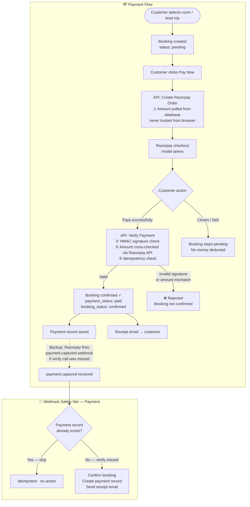
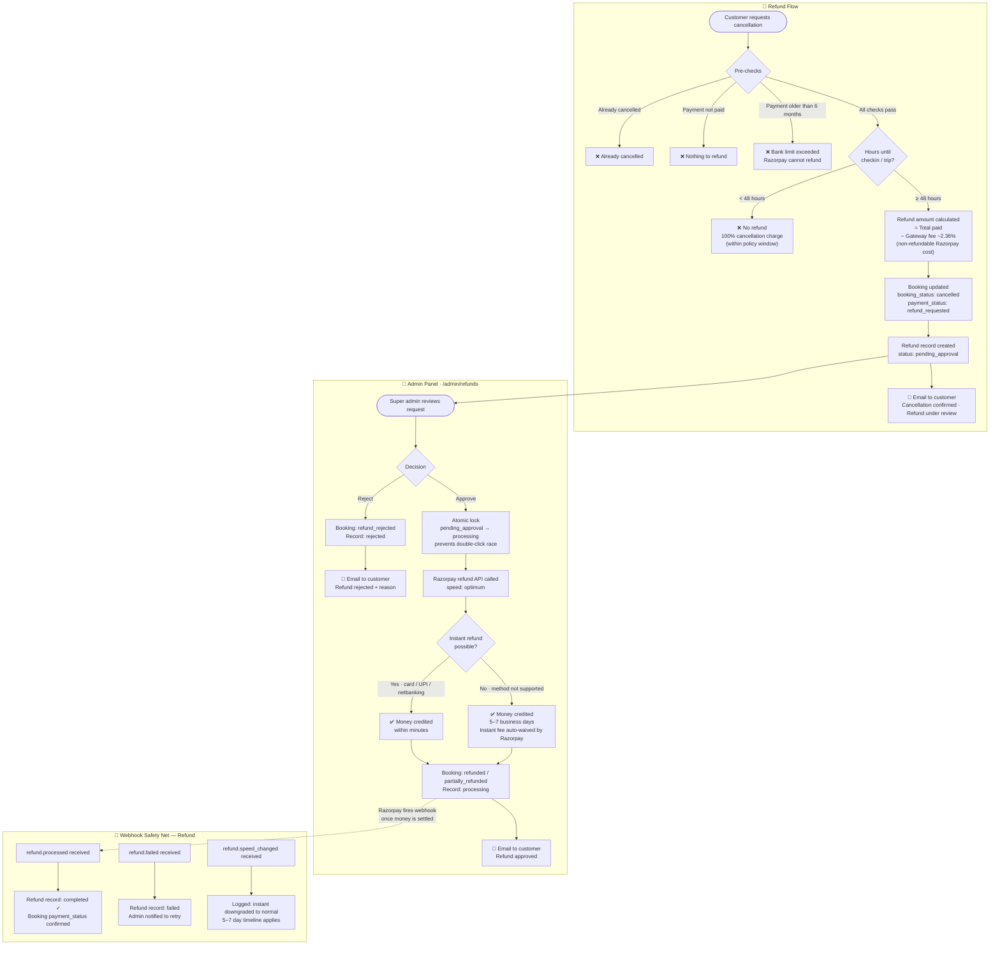
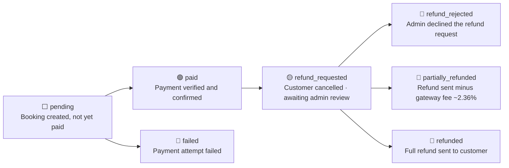

# Payment & Refund Transaction Flow

> **Audience:** Client / stakeholder overview of all money-related operations on Triplovia.
> Generated: 2026-04-12

---

## Payment Flow

---

## Refund Flow

---

## Payment Status Reference

---

## Key Rules

| Rule | Detail |
|------|--------|
| **Amount source** | Always fetched from the database — never trusted from the browser |
| **Signature verification** | Every payment verified with HMAC SHA-256 before confirming |
| **Admin approval required** | No refund is processed automatically — super admin must approve |
| **hotel_admin cannot action refunds** | Only `super_admin` / `admin` role sees Approve / Reject |
| **48-hour cancellation window** | Cancellations ≥ 48 h before check-in/trip get a refund minus gateway fee |
| **Gateway fee ~2.36%** | Razorpay's processing cost — non-refundable from the bank, always deducted |
| **6-month hard limit** | Razorpay / banks cannot process refunds on payments older than 6 months |
| **Instant vs normal speed** | `optimum` speed tries instant first; auto-falls back to 5–7 days if unavailable. Fee is waived on fallback. |
| **Idempotency** | Both payment verify and admin approval are protected against double-processing |
| **Webhook safety net** | `payment.captured` and `refund.processed` webhooks act as a backup in case API calls are missed |
